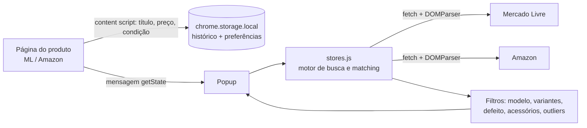

<p align="center">
  
</p>

<h1 align="center">GarimpoTech</h1>

<p align="center">
  Extensão para Chrome que compara preços de artigos tech — <b>novos e usados</b> — entre <b>Mercado Livre</b> e <b>Amazon</b>, com busca por modelo equivalente, detecção de preços suspeitos e histórico de preços.
</p>

<p align="center">
  
  
  
  
</p>

> **EN — TL;DR:** A dependency-free Chrome (Manifest V3) extension that compares prices of computer hardware (GPU, CPU, RAM, SSD), new and used, across Mercado Livre and Amazon Brazil. Highlights: a model-matching engine ("RTX 4060 MSI" → any brand of RTX 4060, but never a 4060 Ti), resilient HTML scraping with fallbacks, outlier-price detection, self-verifying condition filters, a local price history, unit tests with Node's built-in runner and CI on GitHub Actions.

## Por que este projeto existe

Em uma loja de informática com foco em **usados**, precificar um item exige abrir várias abas, filtrar anúncios com defeito, desconfiar de preços-isca e comparar modelos que o título quase nunca descreve igual (*"RTX 4060 8G"*, *"Placa de vídeo 4060"*, *"Galax RTX4060 OC"*). O GarimpoTech automatiza esse trabalho dentro do popup do navegador.

<!-- Adicione capturas de tela e descomente:
<p align="center"></p>
-->

## Funcionalidades

- **Busca genérica por equivalentes** (chave liga/desliga no popup): `RTX 4060 MSI` → procura *RTX 4060* de qualquer fabricante.
- **Reconhecimento de variantes:** `4060 ≠ 4060 Ti`, `5600 ≠ 5600X ≠ 5600G`, `8 GB ≠ 16 GB`.
- **Novos e usados:** filtro de condição no Mercado Livre, com **verificação automática** de que o filtro foi aplicado (compara com uma busca de controle).
- **Mercado Livre como referência:** menor, mediana e maior preço; a Amazon complementa a comparação.
- **Busca por relevância + por menor preço**, mesclando e eliminando duplicatas.
- **Detecção de preços suspeitos** (abaixo de 50% da mediana): ficam fora das estatísticas e são listados à parte.
- **Filtros de qualidade:** oculta anúncios com defeito, "para retirada de peças", acessórios e PCs/notebooks completos — entendendo que *"sem defeito"* não é defeito.
- **Contexto do anúncio aberto:** posição entre os concorrentes e comparação com a mediana do mercado; o próprio anúncio é excluído dos resultados.
- **Histórico de preços local** com mínimo, média, máximo e gráfico.
- **Diagnóstico transparente:** se uma loja bloquear ou mudar o layout, o popup informa o motivo em vez de mostrar resultados vazios.

## Como funciona



1. O **content script** lê o anúncio aberto (com *fallback* para JSON-LD) e registra o preço no histórico local.
2. O **popup** monta a consulta (genérica ou exata) e dispara as buscas em paralelo, mostrando cada loja assim que responde.
3. O **motor de correspondência** (`stores.js`) normaliza títulos, extrai o *modelo núcleo* e descarta o que não é equivalente.
4. Os resultados passam por filtros de qualidade e por detecção de *outliers* antes de virar estatísticas.

## Destaques técnicos

| Tema | O que foi feito |
|---|---|
| **Arquitetura MV3** | Content script + service worker + popup compartilhando um módulo único (`stores.js`), que também é importável em Node para testes. |
| **Matching de produtos** | Tokenização que separa letras e números (`rtx4060` → `rtx 4060`), extração do modelo núcleo por padrões (GPU, CPU AMD/Intel, RAM, SSD) e exclusão por variante e capacidade. |
| **Resiliência de scraping** | Estratégia em duas camadas: seletores conhecidos e, se falharem, plano B estrutural (link do anúncio + preço no mesmo bloco). URLs relativas são normalizadas. |
| **Filtro de condição verificável** | Uma busca de controle sem filtro é comparada com a filtrada; se forem quase iguais, o app avisa e **não rotula** anúncios como "usado" sem prova. |
| **Qualidade dos dados** | Remoção de frases negadas antes de procurar "defeito", exclusão de acessórios pelo início do título e *outliers* pela mediana. |
| **Privacidade** | Sem servidor, sem coleta; tudo em `chrome.storage.local`. Permissões mínimas (`storage` + dois domínios). |
| **Qualidade de código** | Zero dependências em runtime, testes com o *test runner* nativo do Node, CI no GitHub Actions. |

## Stack e ferramentas

- **JavaScript (ES2022)**, HTML5, CSS3 — sem frameworks nem bundler
- **Chrome Extensions API (Manifest V3):** content scripts, service worker, `chrome.storage`, `chrome.tabs`, mensagens entre contextos
- **DOMParser** para leitura de HTML das lojas; **SVG** para o gráfico do histórico e o logotipo
- **Node.js `node:test`** para testes unitários
- **GitHub Actions** para integração contínua
- **Git/GitHub** para versionamento

## Estrutura

```
garimpotech/
├── extension/            # código publicado na Chrome Web Store
│   ├── manifest.json
│   ├── stores.js         # lojas + motor de matching (compartilhado)
│   ├── content.js        # lê o anúncio aberto e grava o histórico
│   ├── background.js     # service worker (requisições)
│   ├── popup.html|css|js # interface
│   └── icons/
├── tests/matching.test.js
├── docs/                 # logotipo e textos da loja
├── .github/workflows/ci.yml
├── PRIVACY.md
└── LICENSE
```

## Instalação (modo desenvolvedor)

1. Clone: `git clone https://github.com/Godoik/Garimpotech-Extension.git`
2. Abra `chrome://extensions` e ative o **Modo do desenvolvedor**.
3. **Carregar sem compactação** → selecione a pasta `extension/`.
4. Abra um produto no Mercado Livre ou na Amazon e clique no ícone do GarimpoTech — ou clique em qualquer aba e digite um termo.

## Testes

```bash
npm test          # testes unitários do motor de matching
npm run lint:syntax
```

## Limitações conhecidas e próximos passos

- A leitura depende do HTML público das lojas; mudanças de layout ou bloqueios (captcha) podem afetar resultados — o popup sinaliza quando isso acontece.
- A Amazon entra apenas em buscas de produtos **novos** (não há filtro de usados implementado).
- Os *parsers* ainda não têm testes com HTML de exemplo (*fixtures*).
- Roadmap: monitoramento com alerta de queda de preço, exportação CSV, mais categorias de produto reconhecidas (placas-mãe, fontes, monitores) e internacionalização.

## Aviso legal

Projeto independente, **sem vínculo** com Mercado Livre ou Amazon; os nomes pertencem aos respectivos proprietários. Use de forma responsável e respeite os termos de uso de cada site. Os preços exibidos são lidos das páginas públicas no momento da consulta e podem mudar.

## Privacidade

Nenhum dado sai do seu navegador. Veja [PRIVACY.md](PRIVACY.md).

## Licença

[MIT](LICENSE) © Gustavo Godoi — [LinkedIn](https:/https://www.linkedin.com/in/gustavosantosgodoi) · [GitHub](https://github.com/GodoiK)
